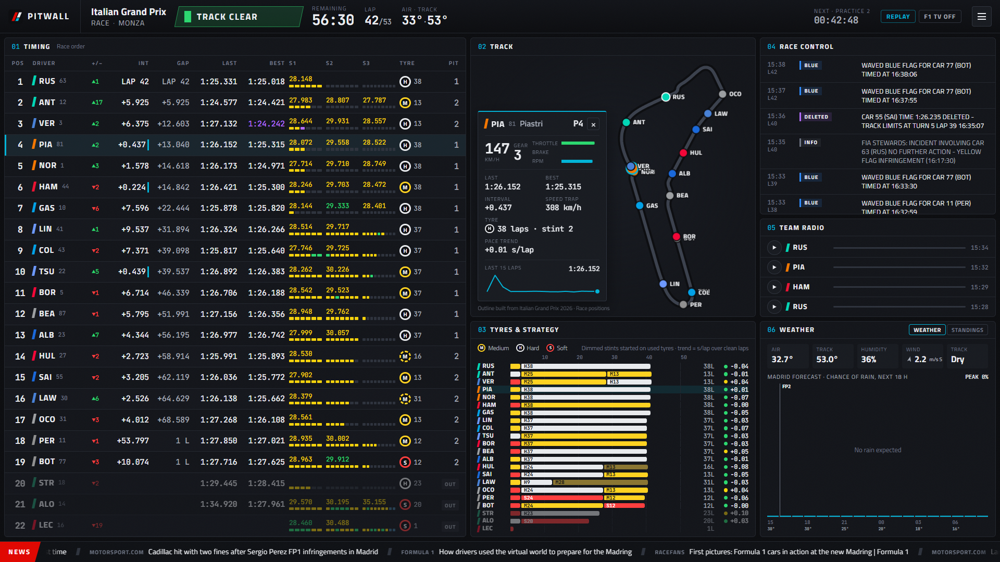
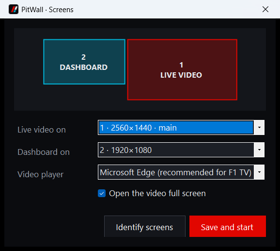
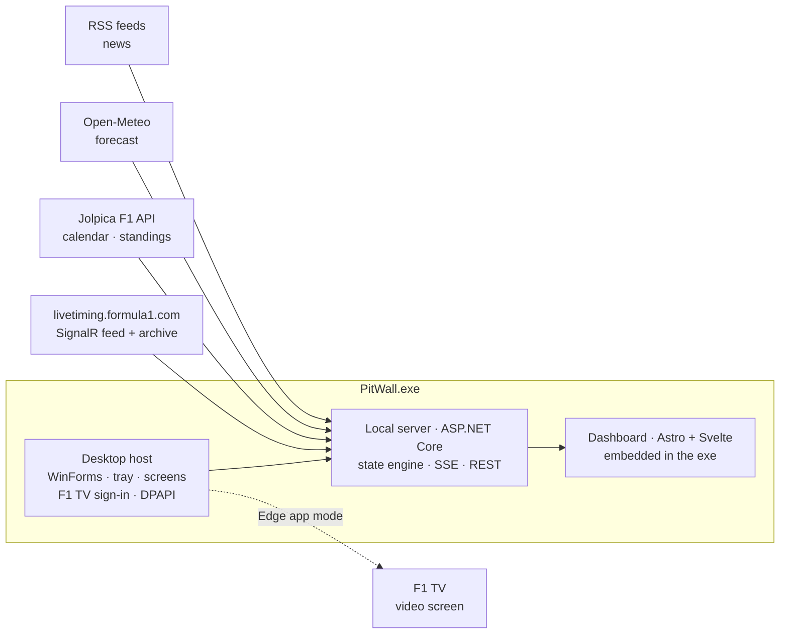

# PitWall

**A Formula 1 race-weekend command centre for two screens.** Live video on one screen. On the other: the timing tower, the track map, tyre strategy, race control, team radio, weather and the news, all updating live.

[](#build-from-source)
[](web/)
[](#run-it)
[](LICENSE)
[](https://github.com/juandresrodca/PitWall/actions/workflows/ci.yml)



<sub>The 2026 Italian Grand Prix replayed from Formula 1's public timing archive, 41 laps in, with Verstappen selected.</sub>

---

## What is on screen

| # | Panel | What it shows |
|---|---|---|
| — | **Top bar** | Grand Prix and session, track status (green, yellow, SC, VSC, red) as the loudest thing on screen, session clock, lap counter, air and track temperature, countdown to the next session, and LIVE / REPLAY / broadcast delay / F1 TV status |
| 01 | **Timing** | The classic timing screen: position, places gained since the start, interval, gap, last and best lap, three sectors with mini-sectors in purple/green/yellow, tyre compound and age, pit stops, in-pit, pit exit and retirements. A cyan edge marks a car within a second of the one ahead. Qualifying shows the knockout line. |
| 02 | **Track** | The circuit outline with every car on it, tinted by track status. Click a car or a row to open the driver card: speed, gear, throttle, brake, RPM, speed trap, stint, pace trend and a lap-time sparkline. |
| 03 | **Tyres & strategy** | Every stint of every driver on a lap axis, current tyre age, and a lap-time trend for the current stint in s/lap |
| 04 | **Race control** | Flags, safety car, track-limit deletions, investigations and penalties, colour-coded |
| 05 | **Team radio** | Published radio clips, playable in place |
| 06 | **Weather / Standings** | Live track weather plus the circuit's rain forecast with session markers; the live championship projection during a race, otherwise the standings |
| — | **News ticker** | Headlines from Formula 1, Autosport, Motorsport.com, BBC Sport and RaceFans. Click one to open it in your browser. |

A second page, **Weekend** (press `W`), shows the schedule in your time zone with a countdown, both championships, the news with summaries, and the season calendar.

## How the two screens work

`PitWall.exe` runs everything: a small local web server with the dashboard built in, plus two windows.

- **Dashboard screen**: a borderless full-screen window (WebView2) showing the dashboard.
- **Video screen**: F1 TV, opened full screen in Microsoft Edge's app mode with a profile of its own. F1 TV streams are DRM-protected, and Edge plays them reliably where embedded browsers may not. You sign in to F1 TV there once and Edge remembers it. An embedded-window mode is available too.

The first time it starts with two monitors it asks which is which:



After that it goes straight to both screens. The tray icon has **Swap screens**, **Screen setup…**, **Connect F1 TV account…**, **Open live video** and **Exit**. With one monitor the dashboard takes the screen and the video opens as a normal window.

## F1 TV account

**Since 15 October 2026 an F1 TV subscription is required for live timing and for the session archive.** Formula 1 answers 401 to everything else, so PitWall needs a connected account to show a live session, download a past one, or build a track map. (Before that date the timing tower was public and only car positions, telemetry, the championship projection and pit-lane times needed a subscription.)

1. Tray icon → **Connect F1 TV account…** (or the button on the track map).
2. Formula 1's own sign-in page opens. **You type your password on formula1.com; PitWall never sees it.**
3. Once you are signed in, Formula 1 sets a `login-session` cookie. PitWall keeps only the subscription token inside it, encrypted with Windows DPAPI for your user account (`%LOCALAPPDATA%\PitWall\f1tv.token`), and sends it only to `livetiming.formula1.com`.
4. Tokens last about a week. When one expires the top bar says so, and the sign-in pop-up reappears; until you sign in again Formula 1 serves no timing at all.

For a headless server you can pass the cookie value or the token in the `PITWALL_F1TV_TOKEN` environment variable instead. The repository contains no credentials of any kind.

## Run it

Download `PitWall.exe` from the [latest CI build](https://github.com/juandresrodca/PitWall/actions/workflows/ci.yml) (artifact **PitWall-win-x64**), or [build it yourself](#build-from-source). It is one self-contained file, with no .NET install needed. It needs the Microsoft Edge WebView2 Runtime, which Windows 11 already has.

```text
PitWall.exe                 dashboard + live video on two screens
PitWall.exe --setup         choose the screens again
PitWall.exe --connect       open the F1 TV sign-in pop-up straight away
PitWall.exe --headless      only the dashboard server; open http://127.0.0.1:5320 in any browser
PitWall.exe --replay PATH   start by replaying an archived session
PitWall.exe --port N        dashboard port (default 5320)
PitWall.exe --lan           let a tablet or phone on your network open the dashboard
```

### Keys

| Key | Action |
|---|---|
| `D` | Controls drawer: live or replay, broadcast delay, F1 TV, screens |
| `W` | Weekend page |
| `F11` | Toggle full screen |
| `Space` / `←` `→` | Replay: play/pause, seek 10 s |
| `Esc` | Close the driver card or drawer |

### Broadcast delay

The video usually runs 20–60 seconds behind the timing feed. Set the delay in the controls drawer (`D`) and PitWall holds every update back by that much, so the tower changes when the overtake happens on screen, not before.

### Replay

Any completed session in Formula 1's archive can be replayed at 1–30× with seeking: pick the season, Grand Prix and session in the controls drawer. It is the quickest way to try PitWall between race weekends, and a session replays with full positions and telemetry. Downloading one needs a connected F1 TV account (the archive moved behind the paywall in October 2026); sessions already downloaded stay in `%LOCALAPPDATA%\PitWallrchive` and replay offline.

## Architecture



- **`PitWall.Core`**: the timing engine. It applies Formula 1's partial JSON deltas (objects merge by key, integer-keyed objects patch arrays by index, `_deleted` removes entries), inflates the compressed `.z` topics, records lap history, builds circuit outlines from car positions, and reads the F1 TV token. No dependencies; unit tested.
- **`PitWall.Server`**: connects to the live feed (SignalR Core, reconnect with backoff, token fallback), plays archived sessions, serves one Server-Sent Events stream (a snapshot, then deltas in the order applied), and caches the calendar, standings, forecast and news. It listens on loopback unless you pass `--lan`, and state-changing requests need a custom header, so a web page you visit cannot drive it.
- **`PitWall.Desktop`**: hosts the server in-process, places the windows, runs the sign-in, and keeps the token sealed.
- **`web/`**: Astro pages with Svelte islands. The browser merges deltas with the same algorithm as the server and redraws at most once per animation frame.

**Track maps** are built from the cars' own GPS traces: PitWall finds one clean lap in an archived session at that circuit and resamples it. There is no third-party map data, and new circuits (like the Madring) work once one practice session is archived.

## Build from source

**Step-by-step guide: [docs/BUILD.md](docs/BUILD.md)** (setup, building, the first launch, troubleshooting).

Requirements: .NET 10 SDK, Node.js 22.19+, Windows 10/11.

```powershell
.\build.cmd              # dashboard build, tests, then dist\PitWall.exe
.\build.cmd -Install     # same, then add PitWall to the Start menu
```

Or step by step:

```powershell
cd web; npm ci; npm run build; cd ..          # builds into src/PitWall.Server/wwwroot
dotnet test --project tests/PitWall.Core.Tests
dotnet run --project src/PitWall.Desktop -- --headless
```

For frontend work, run `PitWall.exe --headless` and `npm run dev` in `web/`. Astro proxies `/api` to it.

## Data sources and credits

- **Live timing** from Formula 1's public timing service (`livetiming.formula1.com`). Unofficial use; it can change without notice.
- **Calendar and standings**: [Jolpica F1 API](https://github.com/jolpica/jolpica-f1), the community successor to Ergast.
- **Forecast**: [Open-Meteo](https://open-meteo.com/), free for non-commercial use.
- **News**: the public RSS feeds of Formula 1, Autosport, Motorsport.com, BBC Sport and RaceFans. Headlines link to the publisher.
- **Inspiration**: [f1-dash](https://github.com/slowlydev/f1-dash) by slowlydev showed what a live-timing dashboard can be. PitWall is an independent implementation (C#/.NET and Astro, written from scratch); no code was copied.
- Fonts: Titillium Web and JetBrains Mono (SIL Open Font License).

## Disclaimer

PitWall is an unofficial project, not associated in any way with the Formula 1 companies. F1, FORMULA ONE, FORMULA 1, FIA FORMULA ONE WORLD CHAMPIONSHIP, GRAND PRIX and related marks are trademarks of Formula One Licensing B.V. An F1 TV subscription is your own, under Formula 1's terms. PitWall only opens F1 TV's website and uses the token your own sign-in produces.

## License

[MIT](LICENSE) © 2026 Juan Andres Rodriguez
